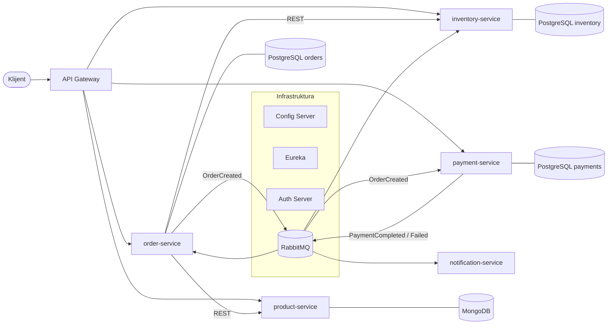

# DIS Online Shop – mikroservisni sistem

Projekat iz predmeta **Distribuirani informacioni sistemi** (FTN Novi Sad, master studije).
Autor: Teodora Bosak, I2 25/2024

Sistem je online prodavnica izgrađena kao skup mikroservisa na **Spring Boot / Spring Cloud** platformi.
Svaka komponenta (mikroservis, baza, message broker) je kontejnerizovana i pokreće se preko Docker Compose-a.

> Status: u izradi. Trenutno postoje infrastrukturne komponente (Config Server, Eureka, Gateway);
> poslovni servisi se dodaju u narednim koracima.

---

## 1. Poslovna logika

Kupac pregleda katalog proizvoda i pravi porudžbinu. Sistem proverava cenu i raspoloživost,
rezerviše robu, naplaćuje porudžbinu i obaveštava kupca o ishodu.

### Poslovni mikroservisi

| Servis | Odgovornost | Baza |
|---|---|---|
| `product-service` | Katalog proizvoda (naziv, opis, cena, atributi) | MongoDB |
| `inventory-service` | Stanje zaliha, rezervacija i oslobađanje robe | PostgreSQL |
| `order-service` | Kreiranje porudžbine i praćenje njenog statusa | PostgreSQL |
| `payment-service` | Obrada (simuliranog) plaćanja | PostgreSQL |
| `notification-service` | Obaveštavanje kupca o promenama statusa porudžbine | – |

### Tok porudžbine

1. Kupac šalje porudžbinu preko Gateway-a → `order-service`.
2. `order-service` **sinhrono (REST)** pita `product-service` za trenutne cene.
3. `order-service` **sinhrono (REST)** traži od `inventory-service` da rezerviše robu.
   Ako roba nije dostupna, porudžbina se odbija odmah.
4. Porudžbina se snima sa statusom `PENDING_PAYMENT` i objavljuje se događaj
   **`OrderCreated`** na RabbitMQ (**asinhrono**).
5. `payment-service` obrađuje plaćanje i objavljuje **`PaymentCompleted`** ili **`PaymentFailed`**.
6. `order-service` menja status u `CONFIRMED` ili `CANCELLED`; kod otkazivanja `inventory-service`
   oslobađa rezervaciju.
7. `notification-service` sluša sve događaje i obaveštava kupca.

### Zašto sinhrono / asinhrono

- **Sinhrono** tamo gde je odgovor neophodan da bi se nastavilo: bez cene i potvrde zaliha
  porudžbina ne može da se kreira. Ovi pozivi su zaštićeni **circuit breaker-om** (Resilience4j).
- **Asinhrono** tamo gde kupac ne mora da čeka: plaćanje i obaveštenja se obrađuju u pozadini,
  pa pad `payment-service`-a ili `notification-service`-a ne blokira prijem porudžbina
  (poruke čekaju u redu dok se servis ne vrati).

### Zašto različite baze (polyglot persistence)

Svaki servis ima **sopstvenu bazu** (database-per-service) kojoj drugi servisi ne pristupaju direktno.
- Katalog proizvoda ima različite atribute po vrsti proizvoda i uglavnom se čita → dokument baza (**MongoDB**).
- Porudžbine, zalihe i plaćanja zahtevaju ACID transakcije → relaciona baza (**PostgreSQL**).

---

## 2. Dijagram sistema



### Infrastrukturne komponente

| Komponenta | Uloga | Port |
|---|---|---|
| `config-server` | Centralizovana konfiguracija svih servisa (folder `config-repo/`) | 8888 |
| `eureka-server` | Service discovery – servisi se nalaze po imenu, ne po IP adresi | 8761 |
| `gateway` | Jedinstvena ulazna tačka, rutiranje ka servisima | 8080 |
| `auth-server` | Izdavanje OAuth2 tokena *(u izradi)* | – |
| RabbitMQ | Message broker za asinhronu komunikaciju *(u izradi)* | 5672 / 15672 |

---

## 3. Pokretanje

### Preduslovi
- **Docker Desktop** (na Windowsu sa WSL2), dodeljeno bar 6 GB RAM-a – jedino što je neophodno za pokretanje.
  Build se izvršava unutar Docker-a (multi-stage Dockerfile), pa Maven nije potreban.
- Za razvoj u IDE-u: JDK 21 i IntelliJ IDEA (Maven je ugrađen u IntelliJ).

### Lokalno (razvoj)

```bash
docker compose up -d --build
```

Provera:
- Eureka dashboard: http://localhost:8761
- Gateway health: http://localhost:8080/actuator/health

Gašenje: `docker compose down`

---

## 4. Pipeline (build / test / deploy)

Pipeline je definisan u `.github/workflows/ci.yml` (GitHub Actions) i pokreće se na svaki push na `main`:

1. **Build** – kompajliranje svih modula (`mvn clean verify`)
2. **Test** – unit i integracioni testovi
3. **Docker build** – build image-a za sve komponente (`docker compose build`)

*(u izradi: integracioni testovi sa Testcontainers, objavljivanje image-a i deploy po okruženjima – dev / prod)*
