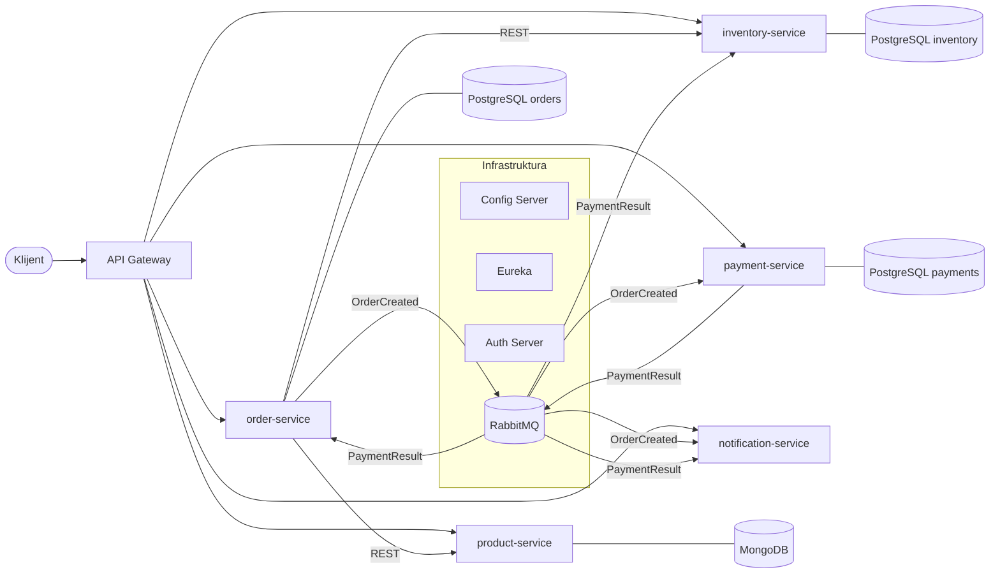

# DIS Online Shop – mikroservisni sistem

Projekat iz predmeta **Distribuirani informacioni sistemi** (FTN Novi Sad, master studije).
Autor: Teodora Bosak, I2 25/2024

Sistem je online prodavnica izgrađena kao skup mikroservisa na **Spring Boot / Spring Cloud** platformi.
Svaka komponenta (mikroservis, baza, message broker) je kontejnerizovana i pokreće se preko Docker Compose-a.

> Status: u izradi. Gotovo: infrastruktura (Config Server, Eureka, Gateway), RabbitMQ i svih pet
> poslovnih servisa sa unit i integracionim testovima. Sledeće: autentifikacija (OAuth2), pipeline po okruženjima.

---

## 1. Poslovna logika

Kupac pregleda katalog proizvoda i pravi porudžbinu. Sistem proverava cenu i raspoloživost,
rezerviše robu, naplaćuje porudžbinu i obaveštava kupca o ishodu.

### Poslovni mikroservisi

| Servis | Odgovornost | Baza |
|---|---|---|
| `product-service` | Katalog proizvoda (naziv, opis, cena, atributi) | MongoDB |
| `inventory-service` | Stanje zaliha, rezervacija i oslobađanje robe | PostgreSQL |
| `order-service` | Kreiranje porudžbine i praćenje njenog statusa | PostgreSQL |
| `payment-service` | Obrada (simuliranog) plaćanja | PostgreSQL |
| `notification-service` | Obaveštavanje kupca o promenama statusa porudžbine | – |

### Tok porudžbine

1. Kupac šalje porudžbinu preko Gateway-a → `order-service`.
2. `order-service` **sinhrono (REST)** pita `product-service` za trenutne cene.
3. `order-service` **sinhrono (REST)** traži od `inventory-service` da rezerviše robu.
   Ako roba nije dostupna, porudžbina se odbija odmah.
4. Porudžbina se snima sa statusom `PENDING_PAYMENT` i objavljuje se događaj
   **`OrderCreated`** na RabbitMQ (**asinhrono**).
5. `payment-service` obrađuje plaćanje (iznos do limita kartice od 200.000 RSD prolazi, preko limita se odbija)
   i objavljuje **`PaymentResult`** sa statusom `COMPLETED` ili `FAILED`.
6. Na `PaymentResult` asinhrono reaguju tri servisa, svaki preko svog reda:
   - `order-service` menja status u `CONFIRMED` ili `CANCELLED`;
   - `inventory-service` trajno skida robu sa stanja (`COMPLETED`) ili oslobađa rezervaciju (`FAILED`);
   - `notification-service` obaveštava kupca.

Ovo je **saga** obrazac: nema jedne transakcije preko više baza, već svaki servis izvršava svoj korak,
a neuspeh se ispravlja kompenzacijom (oslobađanje rezervacije).

### Događaji (RabbitMQ)

| Exchange | Događaj | Objavljuje | Sluša (red) |
|---|---|---|---|
| `orders` | `OrderCreated` | `order-service` | `orders.payment-service`, `orders.notification-service` |
| `payments` | `PaymentResult` | `payment-service` | `payments.order-service`, `payments.inventory-service`, `payments.notification-service` |

Svaki servis koji sluša ima svoju **grupu** (trajni red), pa svaki dobija svoju kopiju poruke. Poruka koja
ne uspe da se obradi ni posle 3 pokušaja ide u *dead letter* red (`<red>.dlq`). Potrošači su
**idempotentni**: ponovljena poruka ne menja ishod (plaćanje se ne naplaćuje dvaput, potvrđena porudžbina
se ne otkazuje).

### REST API (preko gateway-a, port 8080)

| Servis | Putanje |
|---|---|
| `product-service` | `GET/POST /api/products`, `GET/PUT/DELETE /api/products/{id}`, `?category=` |
| `inventory-service` | `GET/PUT /api/inventory/{productId}`, `POST /api/inventory/reservations`, `DELETE /api/inventory/reservations/{orderId}` |
| `order-service` | `POST /api/orders`, `GET /api/orders/{id}`, `GET /api/orders?customerEmail=` |
| `payment-service` | `GET /api/payments`, `GET /api/payments/order/{orderId}` |
| `notification-service` | `GET /api/notifications` |

### Zašto sinhrono / asinhrono

- **Sinhrono** tamo gde je odgovor neophodan da bi se nastavilo: bez cene i potvrde zaliha
  porudžbina ne može da se kreira. Ovi pozivi su zaštićeni **circuit breaker-om** (Resilience4j):
  posle 50% neuspešnih od poslednjih 10 poziva prekidač se otvara na 10 s i porudžbine odmah dobijaju
  `503` umesto da čekaju timeout. Stanje: `/actuator/circuitbreakers` na `order-service`-u.
- **Asinhrono** tamo gde kupac ne mora da čeka: plaćanje i obaveštenja se obrađuju u pozadini,
  pa pad `payment-service`-a ili `notification-service`-a ne blokira prijem porudžbina
  (poruke čekaju u redu dok se servis ne vrati).

### Zašto različite baze (polyglot persistence)

Svaki servis ima **sopstvenu bazu** (database-per-service) kojoj drugi servisi ne pristupaju direktno.
- Katalog proizvoda ima različite atribute po vrsti proizvoda i uglavnom se čita → dokument baza (**MongoDB**).
- Porudžbine, zalihe i plaćanja zahtevaju ACID transakcije → relaciona baza (**PostgreSQL**).

---

## 2. Dijagram sistema



### Infrastrukturne komponente

| Komponenta | Uloga | Port |
|---|---|---|
| `config-server` | Centralizovana konfiguracija svih servisa (folder `config-repo/`) | 8888 |
| `eureka-server` | Service discovery – servisi se nalaze po imenu, ne po IP adresi | 8761 |
| `gateway` | Jedinstvena ulazna tačka, rutiranje ka servisima | 8080 |
| `auth-server` | Izdavanje OAuth2 tokena *(u izradi)* | – |
| RabbitMQ | Message broker za asinhronu komunikaciju (web konzola na 15672, guest/guest) | 5672 / 15672 |

---

## 3. Pokretanje

### Preduslovi
- **Docker Desktop** (na Windowsu sa WSL2), dodeljeno bar 6 GB RAM-a – jedino što je neophodno za pokretanje.
  Build se izvršava unutar Docker-a (multi-stage Dockerfile), pa Maven nije potreban.
- Za razvoj u IDE-u: JDK 21 i IntelliJ IDEA (Maven je ugrađen u IntelliJ).

### Lokalno (razvoj)

```bash
docker compose up -d --build
```

Provera:
- Eureka dashboard: http://localhost:8761 (svih 5 poslovnih servisa + gateway)
- RabbitMQ konzola: http://localhost:15672 (guest / guest) – exchange-i `orders` i `payments` i njihovi redovi
- Gateway health: http://localhost:8080/actuator/health

Primer celog toka (PowerShell):

```powershell
$p = Invoke-RestMethod -Method Post -Uri http://localhost:8080/api/products -ContentType "application/json" -Body '{"name":"Majica","category":"odeca","price":1990}'
Invoke-RestMethod -Method Put -Uri "http://localhost:8080/api/inventory/$($p.id)" -ContentType "application/json" -Body '{"quantity":10}'
$body = @{ customerEmail = "kupac@example.com"; items = @(@{ productId = $p.id; quantity = 2 }) } | ConvertTo-Json -Depth 3
$o = Invoke-RestMethod -Method Post -Uri http://localhost:8080/api/orders -ContentType "application/json" -Body $body
Start-Sleep -Seconds 2
Invoke-RestMethod "http://localhost:8080/api/orders/$($o.id)"          # status: CONFIRMED
Invoke-RestMethod "http://localhost:8080/api/inventory/$($p.id)"       # quantity: 8
Invoke-RestMethod http://localhost:8080/api/notifications
```

Gašenje: `docker compose down`

---

## 4. Pipeline (build / test / deploy)

Pipeline je definisan u `.github/workflows/ci.yml` (GitHub Actions) i pokreće se na svaki push na `main`:

1. **Build** – kompajliranje svih modula (`mvn clean verify`)
2. **Test** – unit i integracioni testovi
3. **Docker build** – build image-a za sve komponente (`docker compose build`)

Integracioni testovi koriste **Testcontainers**: svaki test podiže pravu bazu (PostgreSQL / MongoDB) i pravi
RabbitMQ u Docker kontejneru.

*(u izradi: objavljivanje image-a i deploy po okruženjima – dev / prod)*
